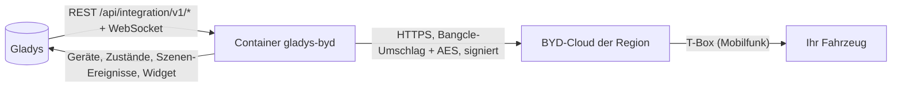
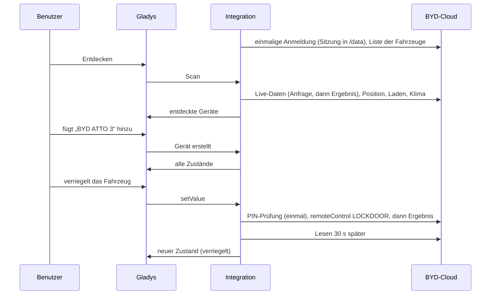
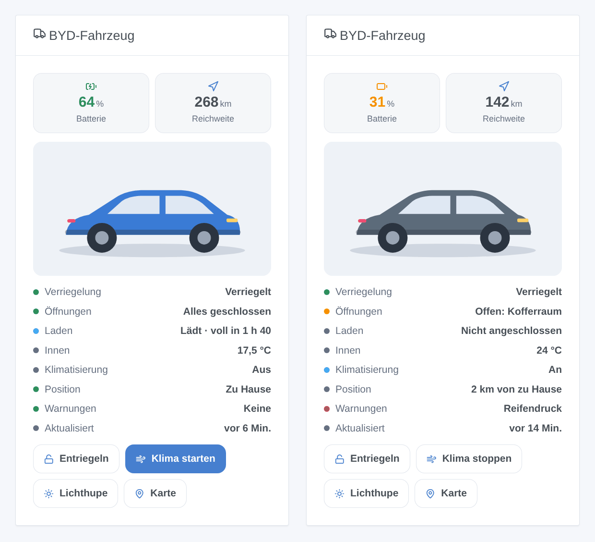

# Gladys BYD

[English](README.md) · [Français](README.fr.md) · **Deutsch** · [Español](README.es.md)

[](LICENSE)
[](https://github.com/William-De71/gladys-byd/releases)
[](https://github.com/William-De71/gladys-byd/actions/workflows/release.yml)
[](https://gladysassistant.com)


Ihr BYD-Elektroauto in [Gladys Assistant](https://gladysassistant.com): Batterie, Reichweite, Laden, Verriegelung, Türen, Klimatisierung, Reifen und Position, über die Cloud der BYD-App. Verriegeln Sie es, starten Sie das Klima oder lassen Sie die Lichter blinken – vom Dashboard oder aus einer Szene.

## Funktionen

- **Ein Gerät pro Fahrzeug** des Kontos: Batteriestand, elektrische Reichweite, Kraftstoffstand und -reichweite (Plug-in-Hybride), Kilometerstand, Ladekabel, Ladestatus, Zeit bis voll geladen, Innentemperatur, Verriegelung, Türen und Kofferraum, Fenster, Klimatisierung, Druck der vier Reifen, Warnungen, Entfernung von zu Hause.
- **Befehle** mit der Fernsteuerungs-PIN der BYD-App: verriegeln, entriegeln, Klima an/aus, Lichtsignal, Fahrzeug finden (Hupe und Licht).
- **7 Szenen-Auslöser**, **2 Szenen-Aktionen** und ein **Dashboard-Widget** (siehe unten).
- Kontoschutz: eine über Neustarts erhaltene Sitzung, eine Pause nach abgelehnter Anmeldung, alle Befehle gestoppt nach abgelehnter PIN.
- Englisch, Französisch, Deutsch und Spanisch.

## Funktionsweise




Vom Scan bis zum Befehl:



BYD veröffentlicht keine API. Der Client ist eine JavaScript-Neufassung nach [pyBYD](https://github.com/jkaberg/pyBYD) (MIT), der Bibliothek der Home-Assistant-Integration [hass-byd-vehicle](https://github.com/jkaberg/hass-byd-vehicle); seine Anfragen wurden Byte für Byte mit pyBYD verglichen. Nur die internationale BYD-App wird unterstützt (nicht die App für China). Der MQTT-Kanal der App wird nicht genutzt: Die Fahrzeuge werden in festen Abständen gelesen.

### Transport

Nur Cloud (`transports: ["cloud"]`): Alles läuft über die BYD-Server der Region Ihres Kontos, außerhalb Ihres Netzwerks – E-Mail-Adresse und Passwort werden wie bei der App an BYD gesendet. Das Geräte-Abzeichen zeigt **Cloud**; **nicht erreichbar**, wenn kein Aufruf für das Fahrzeug gelang; einen orangen Punkt (**eingeschränkt**), wenn BYD das Fahrzeug selbst als offline meldet (Werte evtl. veraltet, Befehle erreichen es evtl. nicht).

## Geräte und Funktionen

| Funktion                                                      | Gladys-Kategorie / Typ                                  | Hinweise                                               |
| ------------------------------------------------------------- | ------------------------------------------------------- | ------------------------------------------------------ |
| Batterie                                                      | `electrical-vehicle-battery/battery-level`              | %                                                      |
| Elektrische Reichweite                                        | `…-battery/battery-range-estimate`                      | km                                                     |
| Kraftstoff, Kraftstoff-Reichweite                             | `level-sensor`, `distance-sensor`                       | nur Plug-in-Hybride                                    |
| Kilometerstand                                                | `electrical-vehicle-state/odometer`                     | km                                                     |
| Ladekabel angeschlossen                                       | `electrical-vehicle-charge/plugged`                     | 0 / 1                                                  |
| Ladestatus, Zeit bis voll geladen                             | `text`, `duration`                                      | lädt / angeschlossen, lädt nicht / nicht angeschlossen |
| Innentemperatur                                               | `electrical-vehicle-climate/indoor-temperature`         | °C                                                     |
| Verriegelung                                                  | `electrical-vehicle-command/lock`                       | Befehl (PIN), 1 = verriegelt                           |
| Türen und Kofferraum, Fenster                                 | `electrical-vehicle-state/door-opened`, `window-opened` | 1 = etwas ist offen                                    |
| Klimatisierung                                                | `electrical-vehicle-climate/climate-on`                 | Befehl (PIN)                                           |
| Reifen vorne links, vorne rechts, hinten links, hinten rechts | `electrical-vehicle-state/tire-pressure`                | bar, unabhängig von der Einheit des Fahrzeugs          |
| Warnungen                                                     | `text`                                                  | Reifen, Bremsen, Antrieb, ABS, Airbag…                 |
| Entfernung von zu Hause                                       | `distance-sensor`                                       | km, zum nächsten Haus in Gladys mit Position           |

Eine Funktion wird angeboten, wenn das Fahrzeug ihren Wert beim Scan meldet: Scannen Sie nach einer ersten Fahrt erneut, falls eine fehlt.

## Szenen-Auslöser, Aktionen und Widgets



**Widget** `BYD-Fahrzeug`: Bild des Modells, Kacheln für Batterie und Reichweite, Verriegelung, Öffnungen, Laden, Innentemperatur, Klima, Position, Warnungen, Alter der Daten und Tasten (ver-/entriegeln, Klima, Lichtsignal – mit PIN – und Karte).

**Auslöser**: ver- oder entriegelt · verriegelt, aber offen · Laden gestartet oder beendet · Kabel ein- oder ausgesteckt · zu Hause angekommen oder abgefahren · Warnleuchte an · Kontoproblem (Anmeldung oder PIN abgelehnt). Jeder enthält das Fahrzeug, eine fertige `summary` und nützliche Werte (Batterie, Reichweite, Entfernung).

**Aktionen**: _Befehl senden_ (verriegeln, entriegeln, Klima an/aus, Lichtsignal, Fahrzeug finden; wartet auf das Fahrzeug) · _Fahrzeugstatus_ (Verriegelung, Öffnungen, Batterie, Reichweite, Laden, Klima, Position, Warnungen, Kartenlink und ein Satz für eine Nachricht).

Beispiele:

- Wenn das Fahrzeug zu Hause ankommt → senden „Fahrzeug anstecken: {{triggerEvent.data.battery_level}} %“.
- Wenn das Fahrzeug verriegelt, aber offen ist → eine Nachricht mit `{{triggerEvent.data.summary}}` senden.
- Jeden Werktag um 7:40 → _Befehl senden_ „Klimatisierung starten“.

## Voraussetzungen

- Gladys Assistant **5.3.0** oder neuer (Katalog-Suchbegriffe und Länder von Gladys 5.3, Widgets und Szenen): Ältere Instanzen können die Integration nicht installieren.
- Ein BYD-Fahrzeug, verbunden mit der internationalen **BYD**-App, und das Konto der App. Ein zweites Konto, mit dem das Fahrzeug geteilt wird, ist empfehlenswert: Die App kann Ihr Telefon abmelden, wenn Gladys sich mit demselben Konto anmeldet.
- Für Befehle: die 6-stellige Fernsteuerungs-PIN der BYD-App (des Kontos, das Gladys nutzt).

## Installation

- **Aus dem Store**: Integrationen → BYD → Installieren.
- **Über die URL des Repositorys**: Integrationen → externe Integration → `https://github.com/William-De71/gladys-byd`.
- **Entwicklermodus**: `npm start` mit den von Gladys gelieferten Variablen starten (siehe Entwicklung).

## Konfiguration

| Feld                  | Standard    | Bedeutung                                                         |
| --------------------- | ----------- | ----------------------------------------------------------------- |
| E-Mail-Adresse        | —           | Das Konto der BYD-App                                             |
| Passwort              | —           | Sein Passwort (`secret`)                                          |
| Land des Kontos       | `FR`        | Zweibuchstabencode: bestimmt den BYD-Server (Europa, Australien…) |
| Fernsteuerungs-PIN    | leer        | 6 Ziffern der BYD-App; leer = nur Lesen                           |
| Abfrageintervall      | 15 min      | 5 bis 480 min; jedes Lesen weckt das Fahrzeug                     |
| Klimatemperatur       | 21 °C       | 15 bis 31 °C                                                      |
| Klimadauer            | 20 min      | 10, 15, 20, 25 oder 30 min                                        |
| Radius um das Zuhause | 200 m       | Entfernung, unter der das Fahrzeug zu Hause ist                   |
| Sprache der Texte     | automatisch | Namen, Zustände und Szenen-Zusammenfassungen                      |

## Verwendung

1. Konto (und PIN für Befehle) eintragen, dann **Verbindung testen** klicken.
2. **Entdecken**, dann Ihre Fahrzeuge hinzufügen.
3. Das Widget einem Dashboard hinzufügen und Szenen mit den Auslösern und Aktionen erstellen.

## Entwicklung

```bash
npm install
npm test                       # node --test, nie Netzwerk
npm run lint                   # ESLint
npm run format:check           # Prettier
npx github:GladysAssistant/integration-store . --skip-image-check
scripts/build-cover.sh         # cover.jpg aus docs/assets/cover.svg
docs/illustrations/render.sh   # docs/assets/widgets.<lang>.png
```

Lokal liest das SDK `GLADYS_HOST_API_URL`, `GLADYS_INTEGRATION_TOKEN` und `GLADYS_INTEGRATION_SELECTOR` (von Gladys im Entwicklermodus geliefert). `DEBUG=gladys-integration-sdk` zeigt die SDK-Protokolle. `BYD_DATA_DIR` verlegt die Sitzungsdateien aus `/data`.

Die Tests decken die Kryptografie gegen von pyBYD erzeugte Vektoren ab (Umschlag, AES, Signatur, Checkcode, vollständige Anmeldung und signierte Anfragen), den Client gegen eine nachgebildete BYD-Cloud, die jede Anfrage entschlüsselt und prüft (gehaltene Sitzung, abgelaufene Sitzung, abgelehnte Anmeldung und ihre Pause, PIN-Prüfung und -Sperre, Befehlsergebnisse), das Lesen der Antworten, die Geräte, das Widget (`validateWidgetContent`), Szenen-Ereignisse und -Ausgaben, das Manifest, die vier Sprachen, das Release-Skript und die ganze Integration gegen das nachgebildete Gladys des SDK. `test/structure.test.js` friert alle von Benutzern gespeicherten Schlüssel ein.

## Release-Prozess


Jeder Merge auf `main` startet die CI und berechnet dann die Version aus den [Conventional Commits](https://www.conventionalcommits.org/) seit dem letzten Tag: `feat` → Minor, `fix` / `perf` → Patch, `!` oder `BREAKING CHANGE` → Major (ein Minor vor 1.0.0); `docs`, `chore`, `ci`, `test`, `style`, `refactor`, `build` allein veröffentlichen nichts. Der Changelog-Abschnitt wird erzeugt, der Tag gepusht, das Multi-Architektur-Image gebaut, dann erhält `main` den Release-Commit, das GitHub Release wird erstellt und ein letzter Job prüft das öffentliche Image, den Store-Validator und das Topic.

- Der Titel des Pull Requests wird zum Squash-Commit und dann zur Changelog-Zeile: auf Englisch, für den Benutzer (`pr-title.yml` prüft ihn). `CHANGELOG.md` nie von Hand bearbeiten.
- 1.0.0 ist eine Entscheidung: Actions → Release → Run workflow mit `release-as: 1.0.0`. `dry-run` zeigt Version und Notizen, ohne zu veröffentlichen.
- **Geschützter Branch**: Das Release pusht seinen Commit mit `GITHUB_TOKEN` auf `main`. Mit einem Ruleset auf `main` GitHub Actions zur Bypass-Liste hinzufügen (oder eine GitHub App nutzen), sonst schlägt der Publish-Job mit Anleitung fehl.
- Nach dem ersten Release das `ghcr.io`-Paket öffentlich machen (Package settings → Change visibility), sonst kann Gladys es nicht laden.

## Fehlerbehebung

Siehe [docs/de.md](docs/de.md#fehlerbehebung). Melden Sie Probleme mit den Versionen von Gladys und der Integration, dem Fahrzeugmodell, dem Land des Kontos und den Zeilen der Taste **Diagnose** (anonymisiert).

## Mitwirken

Issues und Pull Requests sind willkommen. Vor einem Pull Request `npm run format:check && npm run lint && npm test` ausführen und keine externe ID oder gespeicherten Schlüssel ändern (siehe [CLAUDE.md](CLAUDE.md)).

## Sicherheit

Siehe [SECURITY.md](SECURITY.md): Schwachstellen vertraulich melden. Passwort und PIN sind `secret`-Felder, nie protokolliert; die Sitzung (nie das Passwort) wird in `/data` gehalten. Eine abgelehnte Anmeldung pausiert die Versuche (15 min, verdoppelt bis 4 h) und eine abgelehnte PIN stoppt alle Befehle, damit BYD weder das Konto noch die Fernsteuerung des Fahrzeugs sperrt.

## Kommende Screenshots

Die Bilder oben sind Illustrationen, keine Screenshots. Echte Screenshots kommen nach `docs/assets/screenshots/` (PNG, 1280 × 800): `configuration.png`, `discovery.png`, `device.png`, `widget.png`.

## Lizenz

[Apache License 2.0](LICENSE) – siehe auch [NOTICE](NOTICE). BYD ist eine Marke der BYD Company Limited; diese Community-Integration ist nicht mit ihr verbunden und nutzt eine undokumentierte API, die sich ändern kann. Dank an die Dokumentation und das SDK von Gladys sowie an pyBYD und hass-byd-vehicle.
