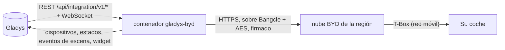
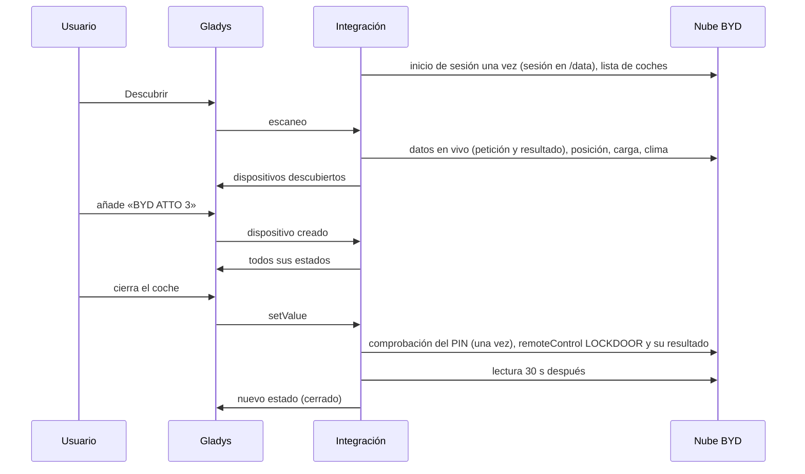
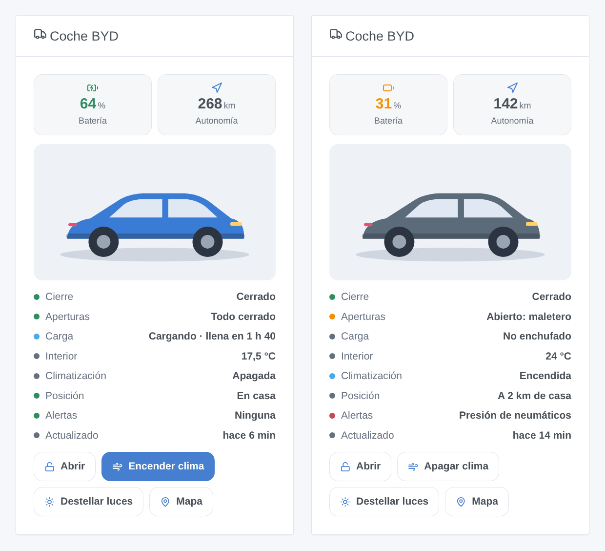

# Gladys BYD

[English](README.md) · [Français](README.fr.md) · [Deutsch](README.de.md) · **Español**

[](LICENSE)
[](https://github.com/William-De71/gladys-byd/releases)
[](https://github.com/William-De71/gladys-byd/actions/workflows/release.yml)
[](https://gladysassistant.com)


Su coche eléctrico BYD en [Gladys Assistant](https://gladysassistant.com): batería, autonomía, carga, cierre, puertas, climatización, neumáticos y posición, a través de la nube de la app BYD. Ciérrelo, encienda el clima o haga destellar las luces desde un panel o una escena.

## Funcionalidades

- **Un dispositivo por coche** de la cuenta: nivel de batería, autonomía eléctrica, nivel y autonomía de combustible (híbridos enchufables), cuentakilómetros, cable de carga, estado de la carga, tiempo hasta carga completa, temperatura interior, cierre, puertas y maletero, ventanillas, climatización, presión de los cuatro neumáticos, alertas, distancia de casa.
- **Comandos** con el PIN de control remoto de la app BYD: cerrar, abrir, clima encendido/apagado, destellar luces, localizar coche (claxon y luces).
- **7 disparadores de escena**, **2 acciones de escena** y un **widget de panel** (ver abajo).
- Seguridad de la cuenta: una sola sesión conservada entre reinicios, una pausa tras un inicio de sesión rechazado, todos los comandos detenidos tras un PIN rechazado.
- Inglés, francés, alemán y español.

## Funcionamiento




Del escaneo a un comando:



BYD no publica ninguna API. El cliente es una reescritura en JavaScript a partir de [pyBYD](https://github.com/jkaberg/pyBYD) (MIT), la biblioteca de la integración de Home Assistant [hass-byd-vehicle](https://github.com/jkaberg/hass-byd-vehicle); sus peticiones se compararon byte a byte con las de pyBYD. Solo se admite la app BYD internacional (no la app para China). El canal MQTT de la app no se usa: los coches se leen a intervalos regulares.

### Transporte

Solo nube (`transports: ["cloud"]`): todo pasa por los servidores de BYD de la región de su cuenta, fuera de su red — su correo y su contraseña se envían a BYD, como hace la app. La insignia del dispositivo indica **nube**; **inaccesible** cuando ninguna llamada funcionó para el coche; un punto naranja (**degradado**) cuando BYD indica que el propio coche está sin conexión (valores quizá antiguos, comandos quizá sin llegar).

## Dispositivos y funcionalidades

| Funcionalidad                                                                         | Categoría / tipo de Gladys                              | Notas                                                    |
| ------------------------------------------------------------------------------------- | ------------------------------------------------------- | -------------------------------------------------------- |
| Batería                                                                               | `electrical-vehicle-battery/battery-level`              | %                                                        |
| Autonomía eléctrica                                                                   | `…-battery/battery-range-estimate`                      | km                                                       |
| Combustible, autonomía de combustible                                                 | `level-sensor`, `distance-sensor`                       | solo híbridos enchufables                                |
| Cuentakilómetros                                                                      | `electrical-vehicle-state/odometer`                     | km                                                       |
| Cable de carga enchufado                                                              | `electrical-vehicle-charge/plugged`                     | 0 / 1                                                    |
| Estado de la carga, tiempo hasta carga completa                                       | `text`, `duration`                                      | cargando / enchufado sin cargar / no enchufado           |
| Temperatura interior                                                                  | `electrical-vehicle-climate/indoor-temperature`         | °C                                                       |
| Cierre                                                                                | `electrical-vehicle-command/lock`                       | comando (PIN), 1 = cerrado                               |
| Puertas y maletero, ventanillas                                                       | `electrical-vehicle-state/door-opened`, `window-opened` | 1 = algo está abierto                                    |
| Climatización                                                                         | `electrical-vehicle-climate/climate-on`                 | comando (PIN)                                            |
| Neumáticos delantero izquierdo, delantero derecho, trasero izquierdo, trasero derecho | `electrical-vehicle-state/tire-pressure`                | bar, sea cual sea la unidad del coche                    |
| Alertas                                                                               | `text`                                                  | neumáticos, frenos, propulsión, ABS, airbag…             |
| Distancia de casa                                                                     | `distance-sensor`                                       | km, hasta la vivienda de Gladys con posición más cercana |

Una funcionalidad se ofrece cuando el coche da su valor en el escaneo: vuelva a escanear tras un primer trayecto si falta alguna.

## Disparadores, acciones de escena y widgets



**Widget** `Coche BYD`: la foto del modelo, mosaicos de batería y autonomía, cierre, aperturas, carga, temperatura interior, clima, posición, alertas, antigüedad de los datos y botones (cerrar/abrir, clima, destellar luces — con el PIN — y el mapa).

**Disparadores**: cerrado o abierto · cerrado pero abierto · carga iniciada o detenida · cable enchufado o desenchufado · llegada o salida de casa · testigo de alerta encendido · problema de cuenta (inicio de sesión o PIN rechazado). Cada uno lleva el coche, un `summary` listo para usar y valores útiles (batería, autonomía, distancia).

**Acciones**: _enviar un comando_ (cerrar, abrir, clima encendido/apagado, destellar luces, localizar coche; espera al coche) · _estado del coche_ (cierre, aperturas, batería, autonomía, carga, clima, posición, alertas, enlace al mapa y una frase para un mensaje).

Ejemplos:

- Cuando el coche llega a casa → enviar «Enchufa el coche: {{triggerEvent.data.battery_level}} %».
- Cuando el coche está cerrado pero abierto → enviar un mensaje con `{{triggerEvent.data.summary}}`.
- Cada día laborable a las 7:40 → _enviar un comando_ «Encender la climatización».

## Requisitos

- Gladys Assistant **5.3.0** o posterior (palabras clave y países del catálogo de Gladys 5.3, widgets y escenas): las instancias más antiguas no pueden instalar la integración.
- Un coche BYD conectado a la app **BYD** internacional, y la cuenta de la app. Se aconseja una segunda cuenta con la que se comparta el coche: la app puede cerrar la sesión de su teléfono cuando Gladys inicia sesión con la misma cuenta.
- Para los comandos: el PIN de control remoto de 6 cifras definido en la app BYD (por la cuenta que usa Gladys).

## Instalación

- **Desde la tienda**: Integraciones → BYD → Instalar.
- **Desde la URL del repositorio**: Integraciones → integración externa → `https://github.com/William-De71/gladys-byd`.
- **Modo desarrollador**: ejecute `npm start` con las variables que da Gladys (ver Desarrollo).

## Configuración

| Campo                 | Por defecto | Función                                                             |
| --------------------- | ----------- | ------------------------------------------------------------------- |
| Correo electrónico    | —           | La cuenta de la app BYD                                             |
| Contraseña            | —           | Su contraseña (`secret`)                                            |
| País de la cuenta     | `FR`        | Código de dos letras: elige el servidor de BYD (Europa, Australia…) |
| PIN de control remoto | vacío       | 6 cifras de la app BYD; vacío = solo lectura                        |
| Intervalo de lectura  | 15 min      | 5 a 480 min; cada lectura despierta el coche                        |
| Temperatura del clima | 21 °C       | 15 a 31 °C                                                          |
| Duración del clima    | 20 min      | 10, 15, 20, 25 o 30 min                                             |
| Radio de la vivienda  | 200 m       | Distancia por debajo de la cual el coche está en casa               |
| Idioma de los textos  | automático  | Nombres, estados y resúmenes de escenas                             |

## Uso

1. Rellene la cuenta (y el PIN para los comandos) y haga clic en **Probar la conexión**.
2. **Descubrir** y añada sus coches.
3. Añada el widget a un panel y cree escenas con los disparadores y acciones.

## Desarrollo

```bash
npm install
npm test                       # node --test, nunca toca la red
npm run lint                   # ESLint
npm run format:check           # Prettier
npx github:GladysAssistant/integration-store . --skip-image-check
scripts/build-cover.sh         # cover.jpg desde docs/assets/cover.svg
docs/illustrations/render.sh   # docs/assets/widgets.<lang>.png
```

En local, el SDK lee `GLADYS_HOST_API_URL`, `GLADYS_INTEGRATION_TOKEN` y `GLADYS_INTEGRATION_SELECTOR` (que da Gladys en modo desarrollador). `DEBUG=gladys-integration-sdk` muestra los registros del SDK. `BYD_DATA_DIR` mueve los archivos de sesión fuera de `/data`.

Las pruebas cubren la criptografía contra vectores producidos por pyBYD (sobre, AES, firma, checkcode, inicio de sesión completo y peticiones firmadas), el cliente contra una nube BYD simulada que descifra y comprueba cada petición (sesión conservada, sesión caducada, inicio de sesión rechazado y su pausa, comprobación y bloqueo del PIN, resultados de comandos), la lectura de las respuestas, los dispositivos, el widget (`validateWidgetContent`), los eventos y salidas de escena, el manifiesto, los cuatro idiomas, el script de publicación y la integración completa contra el Gladys simulado del SDK. `test/structure.test.js` congela todas las claves que guardan los usuarios.

## Proceso de publicación


Cada fusión en `main` lanza la CI y calcula la versión a partir de los [Conventional Commits](https://www.conventionalcommits.org/) desde la última etiqueta: `feat` → menor, `fix` / `perf` → parche, `!` o `BREAKING CHANGE` → mayor (una menor antes de 1.0.0); `docs`, `chore`, `ci`, `test`, `style`, `refactor`, `build` solos no publican nada. Se genera la sección del changelog, se envía la etiqueta, se construye la imagen multiarquitectura, `main` recibe el commit de publicación, se crea la GitHub Release y un último job comprueba la imagen pública, el validador de la tienda y el topic.

- El título de la pull request se convierte en el commit squash y luego en la línea del changelog: escríbalo en inglés, para el usuario (`pr-title.yml` lo comprueba). No edite nunca `CHANGELOG.md` a mano.
- La 1.0.0 es una decisión: Actions → Release → Run workflow con `release-as: 1.0.0`. `dry-run` muestra la versión y las notas sin publicar.
- **Rama protegida**: la publicación envía su commit a `main` con `GITHUB_TOKEN`. Con un ruleset en `main`, añada GitHub Actions a su lista de exclusión (o use una GitHub App); si no, el job de publicación falla con instrucciones.
- Tras la primera publicación, haga público el paquete `ghcr.io` (Package settings → Change visibility), o Gladys no podrá descargarlo.

## Solución de problemas

Ver [docs/es.md](docs/es.md#solución-de-problemas). Informe de los problemas con las versiones de Gladys y de la integración, el modelo del coche, el país de la cuenta y las líneas escritas por el botón **Diagnóstico** (anonimizadas).

## Contribuir

Issues y pull requests son bienvenidas. Ejecute `npm run format:check && npm run lint && npm test` antes de abrir una pull request y no cambie ningún identificador externo ni clave guardada (ver [CLAUDE.md](CLAUDE.md)).

## Seguridad

Ver [SECURITY.md](SECURITY.md): informe de las vulnerabilidades en privado. La contraseña y el PIN son campos `secret`, nunca registrados; la sesión (nunca la contraseña) se guarda en `/data`. Un inicio de sesión rechazado pausa los intentos (15 min, duplicados hasta 4 h) y un PIN rechazado detiene todos los comandos, para que BYD no bloquee ni la cuenta ni el control remoto del coche.

## Capturas por venir

Las imágenes de arriba son ilustraciones, no capturas de pantalla. Las capturas reales irán en `docs/assets/screenshots/` (PNG, 1280 × 800): `configuration.png`, `discovery.png`, `device.png`, `widget.png`.

## Licencia

[Licencia Apache 2.0](LICENSE) — ver también [NOTICE](NOTICE). BYD es una marca de BYD Company Limited; esta integración comunitaria no está afiliada a ella y usa una API no documentada que puede cambiar. Gracias a la documentación y al SDK de Gladys, y a pyBYD y hass-byd-vehicle.
