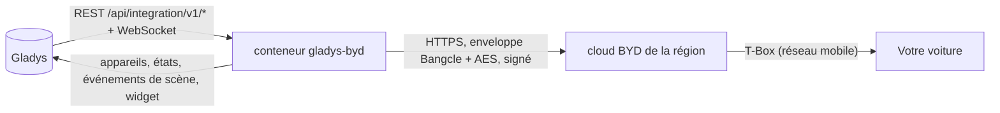
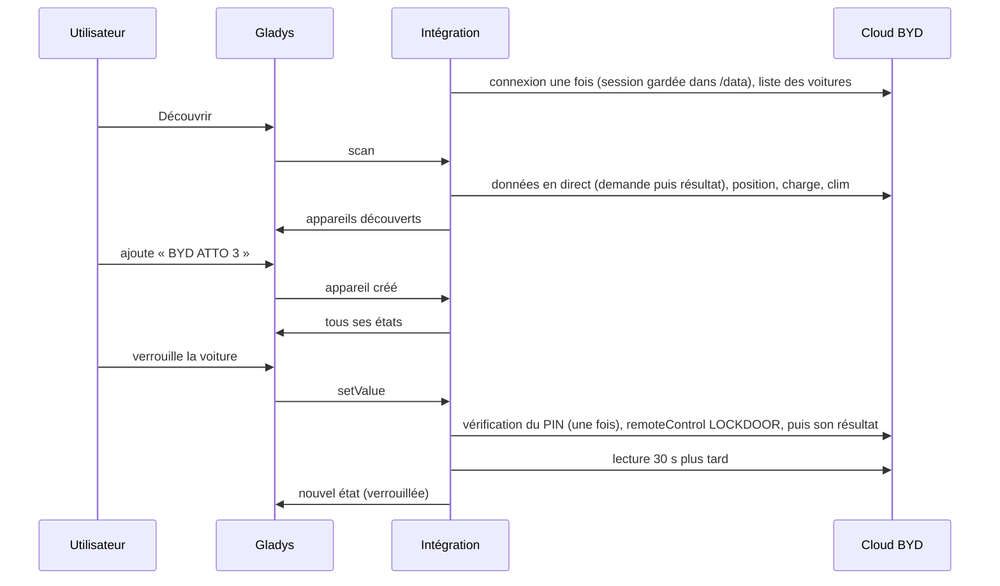
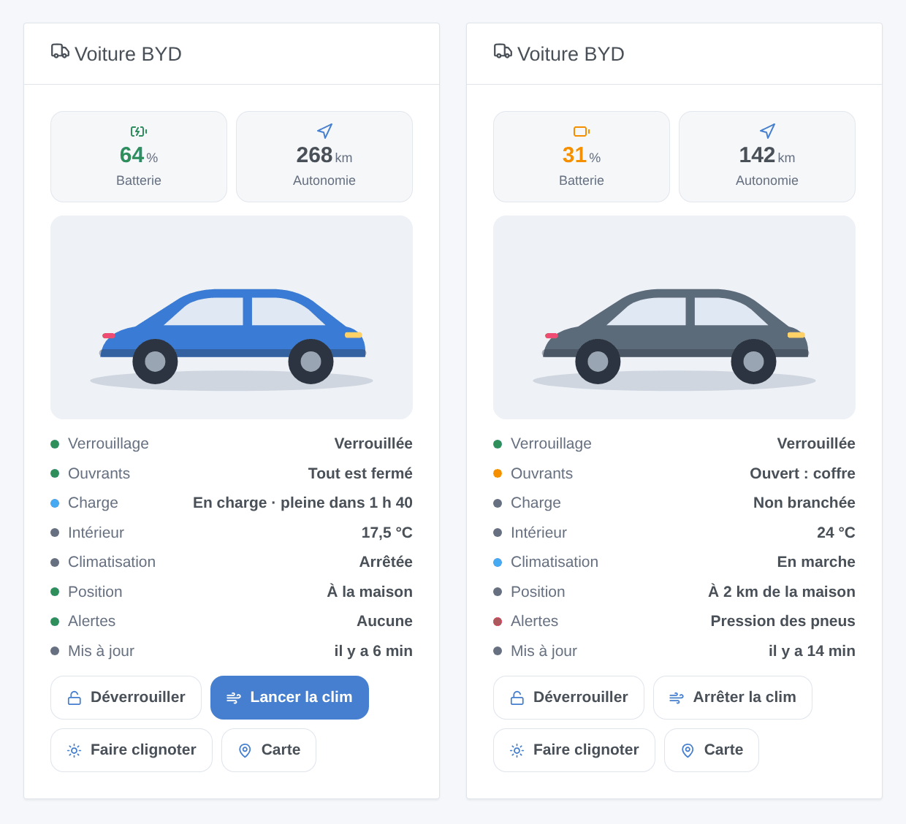

# Gladys BYD

[English](README.md) · **Français** · [Deutsch](README.de.md) · [Español](README.es.md)

[](LICENSE)
[](https://github.com/William-De71/gladys-byd/releases)
[](https://github.com/William-De71/gladys-byd/actions/workflows/release.yml)
[](https://gladysassistant.com)


Votre voiture électrique BYD dans [Gladys Assistant](https://gladysassistant.com) : batterie, autonomie, charge, verrouillage, portes, climatisation, pneus et position, via le cloud de l’app BYD. Verrouillez-la, lancez la clim ou faites clignoter les feux depuis un tableau de bord ou une scène.

## Fonctionnalités

- **Un appareil par voiture** du compte : niveau de batterie, autonomie électrique, niveau et autonomie carburant (hybrides rechargeables), compteur kilométrique, câble de charge, état de la charge, temps avant charge complète, température intérieure, verrouillage, portes et coffre, vitres, climatisation, pression des quatre pneus, alertes, distance du domicile.
- **Commandes** avec le code PIN de commande de l’app BYD : verrouiller, déverrouiller, clim marche/arrêt, faire clignoter les feux, localisation sonore (klaxon et feux).
- **7 déclencheurs de scène**, **2 actions de scène** et un **widget de tableau de bord** (voir plus bas).
- Sécurité du compte : une seule session conservée entre les redémarrages, une pause après une connexion refusée, toutes les commandes suspendues après un PIN refusé.
- Anglais, français, allemand et espagnol.

## Fonctionnement




De la découverte à une commande :



BYD ne publie aucune API. Le client est une réécriture JavaScript d’après [pyBYD](https://github.com/jkaberg/pyBYD) (MIT), la bibliothèque de l’intégration Home Assistant [hass-byd-vehicle](https://github.com/jkaberg/hass-byd-vehicle) ; ses requêtes ont été comparées octet par octet à celles de pyBYD. Seule l’app BYD internationale est prise en charge (pas l’app pour la Chine). Le canal MQTT de l’app n’est pas utilisé : les voitures sont lues à intervalle régulier.

### Transport

Cloud uniquement (`transports: ["cloud"]`) : tout passe par les serveurs BYD de la région de votre compte, hors de votre réseau — votre adresse e-mail et votre mot de passe sont envoyés à BYD, comme le fait l’app. Le badge de l’appareil indique **cloud** ; **injoignable** quand aucun appel n’a abouti pour la voiture ; un point orange (**dégradé**) quand BYD signale la voiture elle-même hors ligne (valeurs peut-être anciennes, commandes peut-être pas transmises).

## Appareils et fonctionnalités

| Fonctionnalité                                                 | Catégorie / type Gladys                                 | Remarques                                                |
| -------------------------------------------------------------- | ------------------------------------------------------- | -------------------------------------------------------- |
| Batterie                                                       | `electrical-vehicle-battery/battery-level`              | %                                                        |
| Autonomie électrique                                           | `…-battery/battery-range-estimate`                      | km                                                       |
| Carburant, autonomie carburant                                 | `level-sensor`, `distance-sensor`                       | hybrides rechargeables uniquement                        |
| Compteur kilométrique                                          | `electrical-vehicle-state/odometer`                     | km                                                       |
| Câble de charge branché                                        | `electrical-vehicle-charge/plugged`                     | 0 / 1                                                    |
| État de la charge, temps avant charge complète                 | `text`, `duration`                                      | en charge / branchée sans charger / non branchée         |
| Température intérieure                                         | `electrical-vehicle-climate/indoor-temperature`         | °C                                                       |
| Verrouillage                                                   | `electrical-vehicle-command/lock`                       | commande (PIN), 1 = verrouillée                          |
| Portes et coffre, vitres                                       | `electrical-vehicle-state/door-opened`, `window-opened` | 1 = quelque chose est ouvert                             |
| Climatisation                                                  | `electrical-vehicle-climate/climate-on`                 | commande (PIN)                                           |
| Pneus avant gauche, avant droit, arrière gauche, arrière droit | `electrical-vehicle-state/tire-pressure`                | bar, quelle que soit l’unité de la voiture               |
| Alertes                                                        | `text`                                                  | pneus, freins, propulsion, ABS, airbag…                  |
| Distance du domicile                                           | `distance-sensor`                                       | km, jusqu’à la maison de Gladys localisée la plus proche |

Une fonctionnalité est proposée quand la voiture donne sa valeur au scan : relancez un scan après un premier trajet s’il en manque une.

## Déclencheurs, actions de scène et widgets



**Widget** `Voiture BYD` : la photo du modèle, tuiles batterie et autonomie, verrouillage, ouvrants, charge, température intérieure, clim, position, alertes, âge des données, et boutons (verrouiller/déverrouiller, clim, faire clignoter — avec le PIN — et la carte).

**Déclencheurs** : verrouillée ou déverrouillée · verrouillée mais ouverte · charge démarrée ou arrêtée · câble branché ou débranché · arrivée ou départ de la maison · voyant d’alerte allumé · problème de compte (connexion ou PIN refusé). Chacun porte la voiture, un `summary` prêt à l’emploi et des valeurs utiles (batterie, autonomie, distance).

**Actions** : _envoyer une commande_ (verrouiller, déverrouiller, clim marche/arrêt, faire clignoter, localisation sonore ; attend la voiture) · _état de la voiture_ (verrouillage, ouvrants, batterie, autonomie, charge, clim, position, alertes, lien de carte et une phrase pour un message).

Exemples :

- Quand la voiture arrive à la maison → envoyer « Branche la voiture : {{triggerEvent.data.battery_level}} % ».
- Quand la voiture est verrouillée mais ouverte → envoyer un message avec `{{triggerEvent.data.summary}}`.
- Chaque matin de semaine à 7 h 40 → _envoyer une commande_ « Lancer la climatisation ».

## Prérequis

- Gladys Assistant **5.3.0** ou plus récent (mots-clés et pays du catalogue de Gladys 5.3, widgets et scènes) : les instances plus anciennes ne peuvent pas installer l’intégration.
- Une voiture BYD reliée à l’app **BYD** internationale, et le compte de l’app. Un second compte avec qui la voiture est partagée est conseillé : l’app peut déconnecter votre téléphone quand Gladys se connecte avec le même compte.
- Pour les commandes : le code PIN de commande à 6 chiffres défini dans l’app BYD (par le compte qu’utilise Gladys).

## Installation

- **Depuis le store** : Intégrations → BYD → Installer.
- **Depuis l’URL du dépôt** : Intégrations → intégration externe → `https://github.com/William-De71/gladys-byd`.
- **Mode développeur** : lancez `npm start` avec les variables fournies par Gladys (voir Développement).

## Configuration

| Champ                  | Défaut      | Rôle                                                                 |
| ---------------------- | ----------- | -------------------------------------------------------------------- |
| Adresse e-mail         | —           | Le compte de l’app BYD                                               |
| Mot de passe           | —           | Son mot de passe (`secret`)                                          |
| Pays du compte         | `FR`        | Code à deux lettres : il choisit le serveur BYD (Europe, Australie…) |
| Code PIN de commande   | vide        | 6 chiffres de l’app BYD ; vide = lecture seule                       |
| Intervalle de lecture  | 15 min      | 5 à 480 min ; chaque lecture réveille la voiture                     |
| Température de la clim | 21 °C       | 15 à 31 °C                                                           |
| Durée de la clim       | 20 min      | 10, 15, 20, 25 ou 30 min                                             |
| Rayon du domicile      | 200 m       | Distance sous laquelle la voiture est à la maison                    |
| Langue des textes      | automatique | Noms, états et résumés de scènes                                     |

## Utilisation

1. Renseignez le compte (et le PIN pour les commandes), puis cliquez sur **Tester la connexion**.
2. **Découvrir**, puis ajoutez vos voitures.
3. Ajoutez le widget à un tableau de bord et créez des scènes avec les déclencheurs et actions.

## Développement

```bash
npm install
npm test                       # node --test, ne touche jamais le réseau
npm run lint                   # ESLint
npm run format:check           # Prettier
npx github:GladysAssistant/integration-store . --skip-image-check
scripts/build-cover.sh         # cover.jpg depuis docs/assets/cover.svg
docs/illustrations/render.sh   # docs/assets/widgets.<lang>.png
```

En local, le SDK lit `GLADYS_HOST_API_URL`, `GLADYS_INTEGRATION_TOKEN` et `GLADYS_INTEGRATION_SELECTOR` (fournis par Gladys en mode développeur). `DEBUG=gladys-integration-sdk` affiche les journaux du SDK. `BYD_DATA_DIR` déplace les fichiers de session hors de `/data`.

Les tests couvrent la cryptographie contre des vecteurs produits par pyBYD (enveloppe, AES, signature, checkcode, login complet et requêtes signées), le client contre un faux cloud BYD qui déchiffre et vérifie chaque requête (session gardée, session expirée, connexion refusée et sa pause, vérification et blocage du PIN, résultats des commandes), la lecture des réponses, les appareils, le widget (`validateWidgetContent`), les événements et sorties de scène, le manifeste, les quatre langues, le script de release et l’intégration complète contre le faux Gladys du SDK. `test/structure.test.js` fige toutes les clés que les utilisateurs stockent.

## Processus de release


Chaque fusion sur `main` lance la CI, puis calcule la version depuis les [Conventional Commits](https://www.conventionalcommits.org/) depuis le dernier tag : `feat` → mineure, `fix` / `perf` → correctif, `!` ou `BREAKING CHANGE` → majeure (une mineure avant 1.0.0) ; `docs`, `chore`, `ci`, `test`, `style`, `refactor`, `build` seuls ne publient rien. La section du changelog est générée, le tag poussé, l’image multi-architecture construite, puis `main` reçoit le commit de release, la GitHub Release est créée et un dernier job vérifie l’image publique, le validateur du store et le topic.

- Le titre de la pull request devient le commit squash puis la ligne du changelog : écrivez-le en anglais, pour l’utilisateur (`pr-title.yml` le vérifie). N’éditez jamais `CHANGELOG.md` à la main.
- La 1.0.0 est une décision : Actions → Release → Run workflow avec `release-as: 1.0.0`. `dry-run` affiche la version et les notes sans rien publier.
- **Branche protégée** : la release pousse son commit sur `main` avec `GITHUB_TOKEN`. Avec un ruleset sur `main`, ajoutez GitHub Actions à sa liste de contournement (ou passez par une GitHub App), sinon le job de publication échoue avec la marche à suivre.
- Après la première release, rendez public le package `ghcr.io` (Package settings → Change visibility), sinon Gladys ne peut pas le télécharger.

## Dépannage

Voir [docs/fr.md](docs/fr.md#dépannage). Signalez les problèmes avec les versions de Gladys et de l’intégration, le modèle de la voiture, le pays du compte, et les lignes écrites par le bouton **Diagnostic** (anonymisées).

## Contribuer

Issues et pull requests bienvenues. Lancez `npm run format:check && npm run lint && npm test` avant d’ouvrir une pull request, et ne changez aucun identifiant externe ni clé stockée (voir [CLAUDE.md](CLAUDE.md)).

## Sécurité

Voir [SECURITY.md](SECURITY.md) : signalez les vulnérabilités en privé. Le mot de passe et le PIN sont des champs `secret`, jamais journalisés ; la session (jamais le mot de passe) est conservée dans `/data`. Une connexion refusée met les essais en pause (15 min, doublés jusqu’à 4 h) et un PIN refusé suspend toutes les commandes, pour que BYD ne bloque ni le compte ni la commande à distance de la voiture.

## Captures à venir

Les images ci-dessus sont des illustrations, pas des captures d’écran. Les vraies captures iront dans `docs/assets/screenshots/` (PNG, 1280 × 800) : `configuration.png`, `discovery.png`, `device.png`, `widget.png`.

## Licence

[Licence Apache 2.0](LICENSE) — voir aussi [NOTICE](NOTICE). BYD est une marque de BYD Company Limited ; cette intégration communautaire n’y est pas affiliée et utilise une API non documentée qui peut changer. Merci à la documentation et au SDK de Gladys, ainsi qu’à pyBYD et hass-byd-vehicle.
