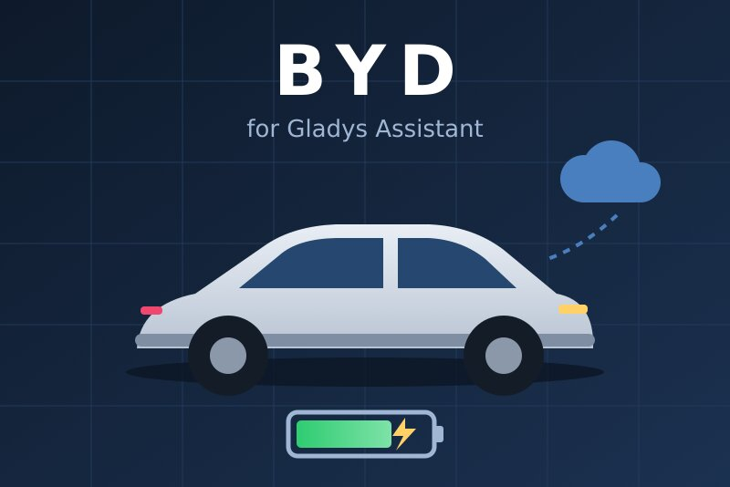
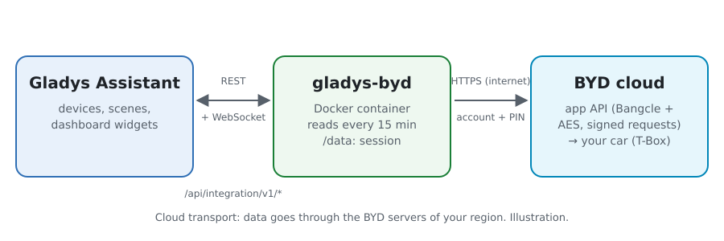
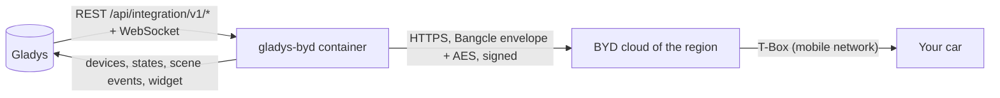
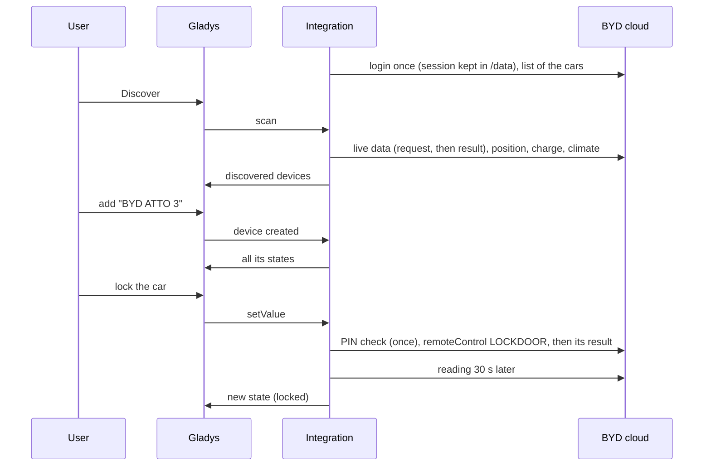
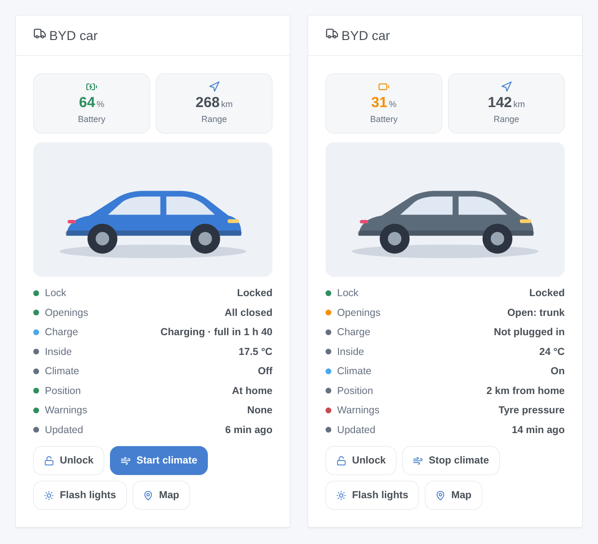

# Gladys BYD

**English** · [Français](README.fr.md) · [Deutsch](README.de.md) · [Español](README.es.md)

[](LICENSE)
[](https://github.com/William-De71/gladys-byd/releases)
[](https://github.com/William-De71/gladys-byd/actions/workflows/release.yml)
[](https://gladysassistant.com)



Your BYD electric car in [Gladys Assistant](https://gladysassistant.com): battery, range, charge, lock, doors, climate, tyres and position, through the cloud of the BYD app. Lock it, start the climate or flash the lights from a dashboard or a scene.

## Features

- **One device per car** of the account: battery level, electric range, fuel level and range (plug-in hybrids), odometer, charging cable, charging status, time to full charge, inside temperature, lock, doors and trunk, windows, climate, four tyre pressures, warnings, distance from home.
- **Commands** with the remote control PIN of the BYD app: lock, unlock, climate on/off, flash the lights, find my car (horn and lights).
- **7 scene triggers**, **2 scene actions** and a **dashboard widget** (see below).
- Account safety: one session kept across restarts, a pause after a refused sign-in, every command stopped after a refused PIN.
- English, French, German and Spanish.

## How it works





From the scan to a command:



BYD publishes no API. The client is a JavaScript rewrite after [pyBYD](https://github.com/jkaberg/pyBYD) (MIT), the library of the Home Assistant integration [hass-byd-vehicle](https://github.com/jkaberg/hass-byd-vehicle); its requests were checked byte for byte against pyBYD. Only the overseas BYD app is supported (not the app for China). The MQTT push channel of the app is not used: the cars are read on a timer.

### Transport

Cloud only (`transports: ["cloud"]`): everything goes through the BYD servers of the region of your account, outside your network — your e-mail address and password are sent to BYD, like the app does. The device badge says **cloud**; **unreachable** when no call succeeded for the car; an orange dot (**degraded**) when BYD says the car itself is offline (values may be old, commands may not reach it).

## Devices and features

| Feature                                             | Gladys category / type                                  | Notes                                              |
| --------------------------------------------------- | ------------------------------------------------------- | -------------------------------------------------- |
| Battery                                             | `electrical-vehicle-battery/battery-level`              | %                                                  |
| Electric range                                      | `…-battery/battery-range-estimate`                      | km                                                 |
| Fuel, fuel range                                    | `level-sensor`, `distance-sensor`                       | plug-in hybrids only                               |
| Odometer                                            | `electrical-vehicle-state/odometer`                     | km                                                 |
| Charging cable plugged in                           | `electrical-vehicle-charge/plugged`                     | 0 / 1                                              |
| Charging status, time to full charge                | `text`, `duration`                                      | charging / plugged, not charging / not plugged in  |
| Inside temperature                                  | `electrical-vehicle-climate/indoor-temperature`         | °C                                                 |
| Lock                                                | `electrical-vehicle-command/lock`                       | command (PIN), 1 = locked                          |
| Doors and trunk, windows                            | `electrical-vehicle-state/door-opened`, `window-opened` | 1 = something is open                              |
| Climate                                             | `electrical-vehicle-climate/climate-on`                 | command (PIN)                                      |
| Tyre front left, front right, rear left, rear right | `electrical-vehicle-state/tire-pressure`                | bar, whatever the unit of the car                  |
| Warnings                                            | `text`                                                  | tyres, brakes, power system, ABS, airbag…          |
| Distance from home                                  | `distance-sensor`                                       | km, to the nearest house of Gladys with a position |

A feature is offered when the car reports its value at the scan: scan again after a first drive if one is missing.

## Scene triggers, actions and widgets



**Widget** `BYD car`: the picture of the model, battery and range tiles, lock, openings, charge, inside temperature, climate, position, warnings, age of the data, and buttons (lock/unlock, climate, flash the lights — with the PIN — and the map).

**Scene triggers**: locked or unlocked · locked but left open · charge started or stopped · cable plugged or unplugged · arrived home or left · warning light on · account problem (sign-in or PIN refused). Each one carries the car, a ready-made `summary` and useful values (battery, range, distance).

**Scene actions**: _send a command_ (lock, unlock, climate on/off, flash the lights, find my car; waits for the car) · _car status_ (lock, openings, battery, range, charge, climate, position, warnings, map link and a sentence for a message).

Examples:

- When the car arrives home → send "Plug the car in: {{triggerEvent.data.battery_level}} %".
- When the car is locked but left open → send a message with `{{triggerEvent.data.summary}}`.
- Every weekday at 7:40 → _send a command_ "Start the climate".

## Requirements

- Gladys Assistant **5.1.1** or later (widgets and scenes): older instances cannot install the integration.
- A BYD car connected to the overseas **BYD** app, and the account of the app. A second account the car is shared with is advised: the app may sign your phone out when Gladys signs in with the same account.
- For commands: the 6-digit remote control PIN set in the BYD app (by the account Gladys uses).

## Installation

- **From the store**: Integrations → BYD → Install.
- **From the repository URL**: Integrations → external integration → `https://github.com/William-De71/gladys-byd`.
- **Developer mode**: run `npm start` with the variables given by Gladys (see Development).

## Configuration

| Field                  | Default   | Meaning                                                               |
| ---------------------- | --------- | --------------------------------------------------------------------- |
| E-mail address         | —         | The account of the BYD app                                            |
| Password               | —         | Its password (`secret`)                                               |
| Country of the account | `FR`      | Two-letter code: it picks the BYD server (Europe, Australia, Brazil…) |
| Remote control PIN     | empty     | 6 digits of the BYD app; empty = read only                            |
| Refresh interval       | 15 min    | 5 to 480 min; each reading wakes the car up                           |
| Climate temperature    | 21 °C     | 15 to 31 °C                                                           |
| Climate duration       | 20 min    | 10, 15, 20, 25 or 30 min                                              |
| Home radius            | 200 m     | Distance under which the car is home                                  |
| Language of the texts  | automatic | Names, statuses and scene summaries                                   |

## Usage

1. Fill in the account (and the PIN for commands), then click **Test the connection**.
2. **Discover**, then add your cars.
3. Add the widget to a dashboard, and build scenes with the triggers and actions.

## Development

```bash
npm install
npm test                       # node --test, never touches the network
npm run lint                   # ESLint
npm run format:check           # Prettier
npx github:GladysAssistant/integration-store . --skip-image-check
scripts/build-cover.sh         # cover.jpg from docs/assets/cover.svg
docs/illustrations/render.sh   # docs/assets/widgets.<lang>.png
```

Locally, the SDK reads `GLADYS_HOST_API_URL`, `GLADYS_INTEGRATION_TOKEN` and `GLADYS_INTEGRATION_SELECTOR` (given by Gladys in developer mode). `DEBUG=gladys-integration-sdk` shows the SDK logs. `BYD_DATA_DIR` moves the session files out of `/data`.

The tests cover the cryptography against vectors produced by pyBYD (envelope, AES, signature, checkcode, whole login and signed requests), the client against a fake BYD cloud that decrypts and checks every request (kept session, expired session, refused login and its pause, PIN check and block, command results), the reading of the answers, the devices, the widget (`validateWidgetContent`), the scene events and outputs, the manifest, the four languages, the release script and the whole integration against the fake Gladys of the SDK. `test/structure.test.js` freezes every key users store.

## Release process


Every merge on `main` runs the CI, then computes the version from the [Conventional Commits](https://www.conventionalcommits.org/) since the last tag: `feat` → minor, `fix` / `perf` → patch, `!` or `BREAKING CHANGE` → major (a minor below 1.0.0); `docs`, `chore`, `ci`, `test`, `style`, `refactor`, `build` alone publish nothing. The changelog section is generated, the tag pushed, the multi-architecture image built, then `main` receives the release commit, the GitHub Release is created and a last job checks the public image, the store validator and the topic.

- The pull request title becomes the squash commit, then the changelog line: write it in English, for the user (`pr-title.yml` checks it). Never edit `CHANGELOG.md` by hand.
- 1.0.0 is a decision: Actions → Release → Run workflow with `release-as: 1.0.0`. `dry-run` shows the version and the notes without publishing.
- **Protected branch**: the release pushes its commit to `main` with `GITHUB_TOKEN`. With a ruleset on `main`, add GitHub Actions to its bypass list (or push through a GitHub App), otherwise the publish job fails with instructions.
- After the first release, make the `ghcr.io` package public (Package settings → Change visibility), or Gladys cannot pull it.

## Troubleshooting

See [docs/en.md](docs/en.md#troubleshooting). Report issues with the versions of Gladys and of the integration, the model of the car, the country of the account, and the lines written by the **Diagnostic** button (anonymized).

## Contributing

Issues and pull requests are welcome. Run `npm run format:check && npm run lint && npm test` before opening a pull request, and keep every external id and stored key unchanged (see [CLAUDE.md](CLAUDE.md)).

## Security

See [SECURITY.md](SECURITY.md): report vulnerabilities privately. The password and the PIN are `secret` fields, never logged; the session (never the password) is kept in `/data`. A refused sign-in pauses the attempts (15 min, doubling up to 4 h) and a refused PIN stops every command, so that BYD does not lock the account or the remote control of the car.

## Screenshots to come

The images above are illustrations, not screenshots. Real screenshots will go in `docs/assets/screenshots/` (PNG, 1280 × 800): `configuration.png`, `discovery.png`, `device.png`, `widget.png`.

## License

[Apache License 2.0](LICENSE) — see also [NOTICE](NOTICE). BYD is a trademark of BYD Company Limited; this community integration is not affiliated with it and uses an undocumented API that may change. Thanks to the Gladys documentation and SDK, and to pyBYD and hass-byd-vehicle.
